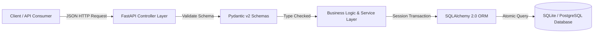

# Book Inventory Management REST API

<p align="center">
  
  
  
  
  
</p>

## 📌 Project Overview

A production-pattern REST API engineered with **FastAPI**, **SQLAlchemy 2.0**, and **Pydantic v2** for managing enterprise bookstore and inventory operations. It features atomic transaction handling, real-time sales accounting, parameterized catalog search, and automated test coverage.

---

## 🎯 Key Features

- **CRUD Operations:** Complete lifecycle management for books (Title, Author, ISBN, Price, Stock).
- **Atomic Sales Transactions:** Atomic decrement of stock inventory with instant revenue calculation.
- **Catalog Search & Filtering:** Dynamic query filtering by author, genre, price range, and availability.
- **Pydantic v2 Data Integrity:** Strict request/response validation schemas preventing invalid data ingress.
- **Interactive Documentation:** Auto-generated Swagger UI (`/docs`) and ReDoc (`/redoc`) API specifications.
- **Comprehensive Test Suite:** Fully automated unit and integration tests using Pytest and HTTPX.

---

## 🏗️ Architecture & Data Model



---

## 🛠️ Verified Technology Stack

| Technology | Version | Purpose |
|---|---|---|
| **Python** | 3.11 / 3.12 | Primary execution runtime |
| **FastAPI** | 0.138.0 | High-performance asynchronous API framework |
| **Uvicorn** | 0.49.0 | ASGI web server implementation |
| **SQLAlchemy** | 2.0.51 | Modern Object Relational Mapper (ORM) |
| **Pydantic** | 2.13.4 | Data parsing, type enforcement, and serialization |
| **Pytest** | 9.1.1 | Automated unit and integration testing harness |
| **HTTPX** | 0.28.1 | Asynchronous HTTP client for test requests |

---

## 📁 Repository Structure

```
book-inventory-api/
├── app/
│   ├── __init__.py           # Package initializer
│   ├── database.py           # Engine setup and SessionLocal factory
│   ├── models.py             # SQLAlchemy ORM declarative models
│   ├── schemas.py            # Pydantic v2 validation schemas
│   ├── crud.py               # Database query and mutation operations
│   └── main.py               # FastAPI application routes and handlers
├── tests/
│   ├── __init__.py
│   └── test_api.py           # Pytest API contract and endpoint tests
├── curl_examples.md          # Copy-pasteable cURL commands
├── postman_collection.json   # Ready-to-import Postman API collection
├── seed_data.py              # Database seeding utility
├── requirements.txt          # Pinned runtime dependencies
├── .env.example              # Environment variables template
└── README.md                 # Project documentation
```

---

## 🚀 Getting Started

### 1. Installation
```bash
git clone https://github.com/purvgandhi/book-inventory-api.git
cd book-inventory-api

python -m venv venv
source venv/bin/activate  # On Windows: .env\Scriptsctivate
pip install -r requirements.txt
```

### 2. Database Initialization & Seeding
```bash
python seed_data.py
```

### 3. Run the Development Server
```bash
uvicorn app.main:app --reload --port 8000
```
Open **http://127.0.0.1:8000/docs** in your browser to interact with the live Swagger documentation.

---

## 🧪 Testing
Run the automated test suite with Pytest:
```bash
pytest -v
```

---

## 👨‍💻 Author & Contact
- **Author:** [Purv Gandhi](https://github.com/purvgandhi)
- **LinkedIn:** [linkedin.com/in/purv-gandhi-17989330a](https://www.linkedin.com/in/purv-gandhi-17989330a/)
- **Email:** [gandhipurv2006@gmail.com](mailto:gandhipurv2006@gmail.com)
